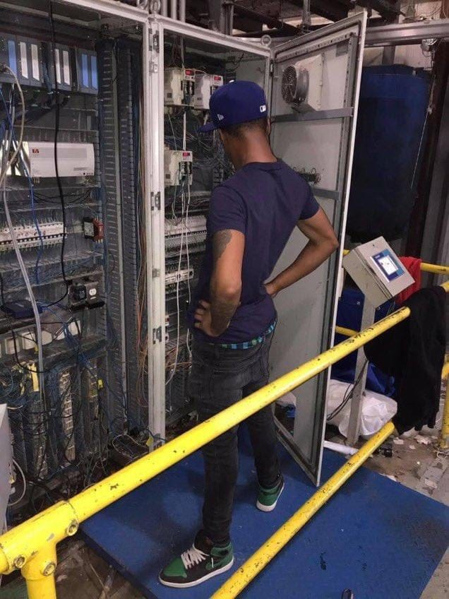

<table>
<tr>
<td width="75%">

<h1>Hi, I'm Mateo Tavella</h1>

<b>Software Developer | IT Support</b>

<h3>About Me</h3>

Currently working at <b>Simplifica</b> as a Software Developer and IT Support professional.

Programming student at Universidad Tecnológica Nacional (UTN), approaching graduation.

Passionate about software development, infrastructure and business process automation.

📍 Concordia, Entre Ríos, Argentina.

</td>
<td width="25%" align="center">

</td>
</tr>
</table>

## Tech Stack

### Development

### Databases

### Tools & Infrastructure

## Professional Experience

**Simplifica | Software Development & IT Support**

- Enterprise software development.
- REST API development and integration.
- Business process automation.
- Database management.
- IT infrastructure and technical support.

## Education

**Universidad Tecnológica Nacional (UTN)**

Programming degree — Near graduation.

---

*"Building solutions, solving problems and constantly learning."*
